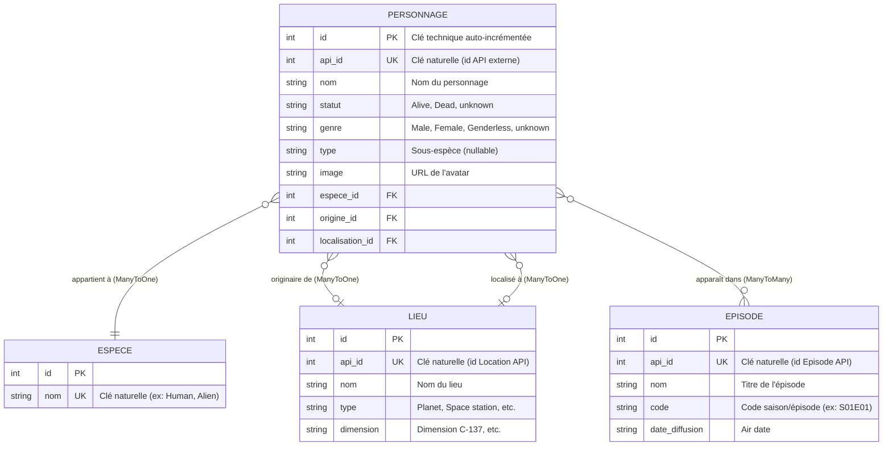

# Rick & Morty API — Plateforme de Données (Symfony 8.1 & API Platform 5)

API REST documentée permettant de stocker, consulter et filtrer les données de l'univers **Rick and Morty**, alimentée automatiquement depuis l'API publique officielle via une commande d'import ETL.

---

## 1. Prérequis et Installation

### Prérequis système
- **PHP 8.4+** avec les extensions activées : `pdo_sqlite`, `sqlite3`, `intl`, `ctype`, `iconv`, `xml`
- **Composer**
- **Symfony CLI**
- **Git**

### Installation de zéro

1. **Cloner le dépôt et accéder au dossier :**
   ```bash
   git clone <URL_DE_VOTRE_REPO_GITHUB>
   cd RickandMorty-main
   ```

2. **Installer les dépendances PHP :**
   ```bash
   composer install
   ```

3. **Configurer la base de données SQLite :**
   Vérifier que le fichier `.env` (ou `.env.local`) contient bien la configuration SQLite :
   ```env
   DATABASE_URL="sqlite:///%kernel.project_dir%/var/data.db"
   ```

4. **Créer les tables via les migrations Doctrine :**
   ```bash
   symfony console doctrine:migrations:migrate -n
   ```

5. **Lancer le serveur local :**
   ```bash
   symfony serve -d
   ```
   L'interface Swagger UI / OpenAPI est accessible sur : `https://127.0.0.1:8000/api`

---

## 2. Architecture et Schéma du Modèle

Le modèle relationnel repose sur **4 entités** normalisées afin d'éviter toute redondance (notamment sur les espèces, les lieux et les épisodes) :

* **`Personnage`** : Entité centrale exposée dans l'API.
* **`Espece`** : Référentiel des espèces (`ManyToOne` depuis `Personnage`).
* **`Lieu`** : Référentiel des planètes et localisations, utilisé à la fois pour l'origine et la dernière localisation connue (`ManyToOne` depuis `Personnage`).
* **`Episode`** : Référentiel des épisodes dans lesquels apparaissent les personnages (`ManyToMany` avec `Personnage`).

### Diagramme Entité-Relation (Mermaid)



---

## 3. Source de données et Commande d'Import (ETL)

### Source externe
- **API :** The Rick and Morty API (`https://rickandmortyapi.com/api/character`)
- **Format :** JSON paginé

### Exécution de l'import
Pour alimenter la base de données depuis l'API externe :
```bash
symfony console app:import-personnages
```
*(Note : La commande est idempotente. Relancer l'import met à jour ou ignore les enregistrements existants sans créer de doublons grâce aux clés naturelles `apiId` et `nom`).*

### Tableau de Mapping (API externe $\rightarrow$ Base de données)

| Champ JSON (API Rick & Morty) | Entité Doctrine | Propriété PHP | Colonne SQL | Remarque / Type |
| :--- | :--- | :--- | :--- | :--- |
| `id` | `Personnage` | `apiId` | `api_id` | Clé naturelle unique (`int`) |
| `name` | `Personnage` | `nom` | `nom` | Obligatoire (`varchar`) |
| `status` | `Personnage` | `statut` | `statut` | `Alive`, `Dead`, `unknown` |
| `species` | `Espece` | `nom` | `nom` | Relation `ManyToOne` (`espece_id`) |
| `type` | `Personnage` | `type` | `type` | Nullable (chaîne vide convertie en `null`) |
| `gender` | `Personnage` | `genre` | `genre` | `Female`, `Male`, `Genderless`, `unknown` |
| `origin.name` / `origin.url` | `Lieu` | `nom` / `apiId` | `origine_id` | Relation `ManyToOne` (nullable si `unknown`) |
| `location.name` / `location.url` | `Lieu` | `nom` / `apiId` | `localisation_id` | Relation `ManyToOne` (nullable si `unknown`) |
| `image` | `Personnage` | `image` | `image` | URL vers l'image (`varchar`) |
| `episode[]` (URLs) | `Episode` | `apiId`, `nom`, `code` | `personnage_episode` | Relation `ManyToMany` via table de jointure |
| `url` / `created` | *(Ignoré)* | — | — | Métadonnées techniques inutiles au domaine |

### Règles de transformation (ETL)

| Règle | Justification métier / technique |
| :--- | :--- |
| **Dédoublonnage des personnages via `apiId`** | Garantit l'idempotence : relancer la commande ne crée jamais deux fois le même personnage. |
| **Cache mémoire en cours d'import (`$especesVues`, `$lieuxVus`, `$episodesVus`)** | Évite les doublons d'entités liées créées avant le `flush()` final de Doctrine. |
| **Normalisation du champ `type`** | Si `type` est une chaîne vide `""` dans le JSON, il est transformé en `null` en base. |
| **Gestion des lieux `unknown`** | Si `origin.url` ou `location.url` est vide (`unknown`), la relation est laissée à `null` plutôt que de créer un faux lieu. |
| **Extraction de l'ID depuis les URLs** | L'identifiant numérique est extrait de la fin des URLs (`.../location/1` $\rightarrow$ `1`) pour servir de clé naturelle `apiId` sur `Lieu` et `Episode`. |

---

## 4. Endpoints principaux (API REST)

Une fois le serveur lancé, les routes suivantes sont disponibles (et testables sur `/api`) :

- `GET /api/personnages` — Liste paginée des personnages (avec espèce, origine, localisation et épisodes)
- `GET /api/personnages/{id}` — Détail d'un personnage
- `POST /api/personnages` — Création d'un personnage (avec validation `422` en cas de données invalides)
- `GET /api/especes` — Liste des espèces
- `GET /api/lieux` — Liste des lieux
- `GET /api/episodes` — Liste des épisodes

---

## 5. Utilisation de l'IA

Dans le cadre de ce projet, des outils d'Intelligence Artificielle générative ont été utilisés comme assistants au développement, sous supervision et relecture systématique de l'équipe :

* **Outils utilisés :** Claude et Gemini.
* **Parties concernées :**
  1. **Aide à la structuration de la commande ETL (`ImportPersonnagesCommand.php`) :** Génération du squelette de la boucle d'import, gestion de la pagination de l'API externe et mise en place des tableaux de cache mémoire avant le `flush()`.
  2. **Débogage Doctrine & API Platform :** Résolution des erreurs de sérialisation circulaire (`#[Groups]`) et ajustement des contraintes de validation (`#[Assert]`).
  3. **Documentation :** Structuration du diagramme Mermaid et mise en forme des tableaux de mapping du `README.md`.
* **Validation humaine :** L'ensemble du modèle de données, des migrations SQLite, des règles métier et du code produit a été relu, testé sur Swagger UI et maîtrisé par les membres du duo pour la soutenance.
