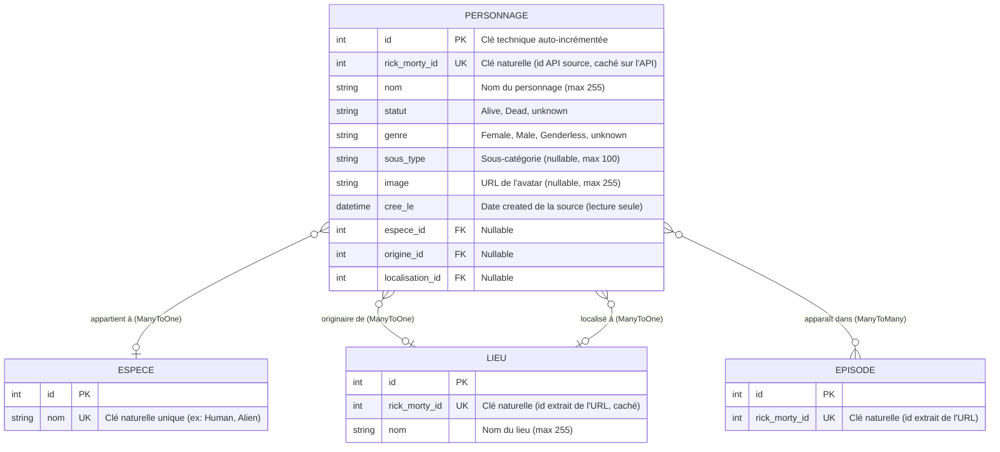

# Rick & Morty API — Plateforme de Données (Symfony 8.1 & API Platform 5)

**Duo :** Loubna Abbar et Sami Cheddad  
**Dépôt GitHub :** https://github.com/LoubnaAbbar/RickandMorty  
**Plan d'architecture :** [docs/mapping.xlsx](docs/mapping.xlsx)

API REST documentée permettant de stocker et consulter les données de l'univers **Rick and Morty**, alimentée automatiquement depuis l'API publique officielle via une commande d'import ETL.

---

## 1. Prérequis et Installation

### Prérequis système
- **PHP 8.4+** avec les extensions activées : `pdo_sqlite`, `sqlite3`, `intl`, `ctype`, `iconv`, `xml`
- **Composer**
- **Symfony CLI**
- **Git**

### Installation de zéro

1. **Cloner le dépôt et accéder au dossier :**
   ```bash
   git clone https://github.com/LoubnaAbbar/RickandMorty.git
   cd RickandMorty
   ```

2. **Installer les dépendances PHP :**
   ```bash
   composer install
   ```

3. **Configurer la base de données SQLite :**
   Vérifier que le fichier `.env` contient bien la configuration SQLite :
   ```env
   DATABASE_URL="sqlite:///%kernel.project_dir%/var/data.db"
   ```

4. **Créer les tables via les migrations Doctrine :**
   ```bash
   symfony console doctrine:migrations:migrate -n
   ```

5. **Importer les données depuis l'API Rick and Morty :**
   ```bash
   symfony console app:import-personnages
   ```

6. **Lancer le serveur local :**
   ```bash
   symfony serve -d
   ```
   L'interface Swagger UI / OpenAPI est accessible sur : `https://127.0.0.1:8000/api`

---

## 2. Architecture et Schéma du Modèle

Le modèle relationnel repose sur **4 entités** normalisées afin d'éviter toute redondance (sur les espèces, les lieux et les épisodes) :

* **`Personnage`** : Entité centrale exposée dans l'API (clé naturelle : `rickMortyId`).
* **`Espece`** : Référentiel des espèces (`ManyToOne` depuis `Personnage`, clé naturelle : `nom`).
* **`Lieu`** : Référentiel des localisations, utilisé à la fois pour l'origine et la dernière position connue (`ManyToOne` depuis `Personnage`, clé naturelle : `rickMortyId`).
* **`Episode`** : Référentiel des épisodes dans lesquels apparaissent les personnages (`ManyToMany` avec `Personnage`, clé naturelle : `rickMortyId`).

### Diagramme Entité-Relation (Mermaid)



---

## 3. Source de données et Commande d'Import (ETL)

### Source externe
- **API :** The Rick and Morty API (`https://rickandmortyapi.com/api/character`)
- **Format :** JSON paginé (826 personnages répartis sur 42 pages de 20 résultats)

### Exécution de l'import
```bash
# Importer l'intégralité des 826 personnages :
symfony console app:import-personnages

# Optionnel : limiter l'import aux N premières pages (ex: 3 pages = 60 personnages) :
symfony console app:import-personnages --pages=3
```
*(La commande est idempotente : relancer l'import ne crée aucun doublon grâce aux clés naturelles `rickMortyId` et `nom`).*

### Tableau de Mapping (API externe $\rightarrow$ Base de données)

Le fichier complet avec validation et groupes de sérialisation est disponible dans [docs/mapping.xlsx](docs/mapping.xlsx).

| Champ JSON (source) | Entité cible | Propriété PHP | Colonne SQL | Règle / Type |
| :--- | :--- | :--- | :--- | :--- |
| `id` | `Personnage` | `rickMortyId` | `rick_morty_id` | Clé naturelle unique (`int`, caché sur l'API) |
| `name` | `Personnage` | `nom` | `nom` | Obligatoire, `trim`, tronqué à 255 caractères |
| `status` | `Personnage` | `statut` | `statut` | `Alive`, `Dead` ou `unknown` |
| `gender` | `Personnage` | `genre` | `genre` | `Female`, `Male`, `Genderless` ou `unknown` |
| `type` | `Personnage` | `sousType` | `sous_type` | Renommé pour éviter le conflit `@type` JSON-LD ; `""` $\rightarrow$ `null` |
| `image` | `Personnage` | `image` | `image` | URL validée (`varchar(255)`), `null` si vide |
| `created` | `Personnage` | `creeLe` | `cree_le` | Converti en `DateTimeImmutable` (lecture seule sur l'API) |
| `species` | `Espece` | `nom` | `espece_id` | Relation `ManyToOne` ; retrouvée par nom ou créée (`null` si vide) |
| `origin.name` / `origin.url` | `Lieu` | `nom` / `rickMortyId` | `origine_id` | Relation `ManyToOne` ; ID extrait de l'URL (`null` si `unknown`) |
| `location.name` / `location.url` | `Lieu` | `nom` / `rickMortyId` | `localisation_id` | Relation `ManyToOne` ; ID extrait de l'URL (`null` si `unknown`) |
| `episode[]` | `Episode` | `rickMortyId` | `personnage_episode` | Relation `ManyToMany` ; ID extrait de chaque URL |
| `url` / `info.next` | *(Non importé)* | — | — | `url` redondante avec l'IRI API Platform ; `info.next` sert uniquement à paginer l'import |

### Règles de transformation (ETL)

| Règle | Description | Justification |
| :--- | :--- | :--- |
| **E — Extraire** | Appels `GET /api/character` en suivant `info.next` jusqu'à `null` (avec pause anti-429). | Récupérer les 826 personnages malgré la pagination de 20 par page. |
| **T1 — Filtrer** | Si `id` n'est pas un entier ou si `name` est vide, le personnage est ignoré. | Donnée inutilisable et interdite par les contraintes `#[Assert\NotBlank]`. |
| **T2 — Dédoublonner** | Si `rickMortyId` est déjà présent dans `$dejaImportes`, le personnage est ignoré. | Garantit l'idempotence lors d'un relancement de la commande. |
| **T3 — Relier Espèce** | Espèce retrouvée par son nom dans `$especes` ou créée ; `null` si vide. | Évite les doublons d'espèces en base. |
| **T4 — Relier Lieux** | ID extrait de la fin de `origin.url` / `location.url` ; lieu retrouvé dans `$lieux` ou créé (`null` si URL vide). | Partage la même table `lieu` entre origine et localisation sans doublon. |
| **T5 — Relier Épisodes** | ID extrait de chaque URL d'épisode ; épisode retrouvé dans `$episodes` ou créé. | Chaque épisode n'est créé qu'une seule fois. |
| **T6 & T7 — Normaliser / Tronquer** | `trim` sur les chaînes, `""` $\rightarrow$ `null`, conversion de `created` en `DateTimeImmutable`, troncature à la taille maximale SQL. | Nettoie les données brutes avant insertion car l'import contourne le Validator API. |
| **L — Charger** | `persist()` sur chaque entité puis un seul `flush()` final. | Optimisation des écritures SQLite en une seule transaction. |

---

## 4. Endpoints principaux (API REST)

Une fois le serveur lancé, les routes suivantes sont disponibles (et testables sur `/api`) :

- `GET /api/personnages` — Liste paginée des personnages (avec `espece`, `origine` et `localisation` embarqués, et `episodes` en IRI)
- `GET /api/personnages/{id}` — Détail d'un personnage
- `POST /api/personnages` — Création d'un personnage (renvoie `422` en cas de violation des contraintes `#[Assert]`)
- `GET /api/especes` — Liste des espèces
- `GET /api/lieux` — Liste des lieux
- `GET /api/episodes` — Liste des épisodes

---

## 5. Utilisation de l'IA

Dans le cadre de ce projet, des outils d'Intelligence Artificielle générative ont été utilisés comme assistants au développement, sous supervision et relecture systématique du duo :

* **Outils utilisés :** Claude et Gemini.
* **Parties concernées :**
  1. **Aide à la structuration de la commande ETL (`ImportPersonnagesCommand.php`) :** Aide à la mise en place de la pagination via `info.next`, de la gestion du code HTTP `429` et des tableaux de mémoire en cours d'import (`$especes`, `$lieux`, `$episodes`, `$dejaImportes`) avant le `flush()`.
  2. **Sérialisation et validation API Platform :** Ajustement des attributs `#[Groups]` (embarquement d'`Espece` et `Lieu` dans `Personnage`, masquage des clés naturelles internes) et des contraintes `#[Assert]`.
  3. **Documentation :** Mise en forme du diagramme Mermaid et des tableaux récapitulatifs du `README.md`.
* **Validation humaine :** L'ensemble du modèle de données, des migrations SQLite, des règles ETL et du code produit a été relu, testé sur Swagger UI et maîtrisé par les deux membres du duo pour la soutenance.